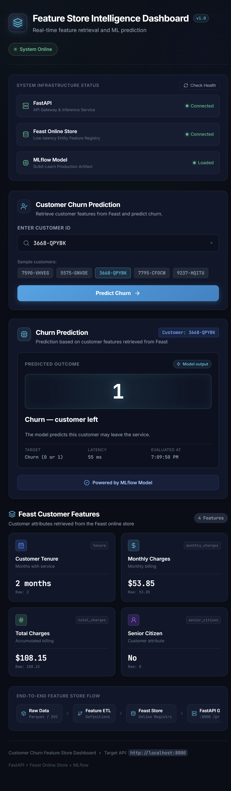
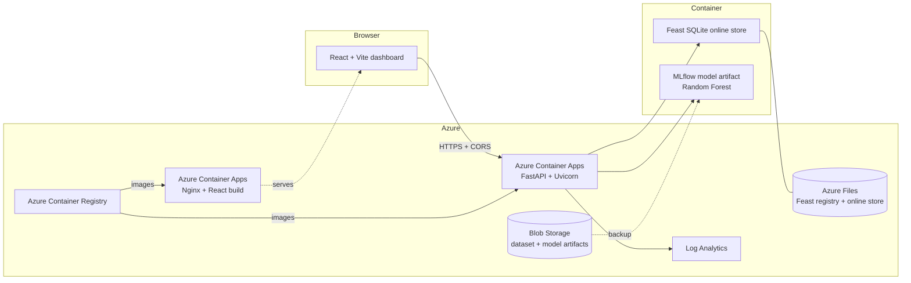
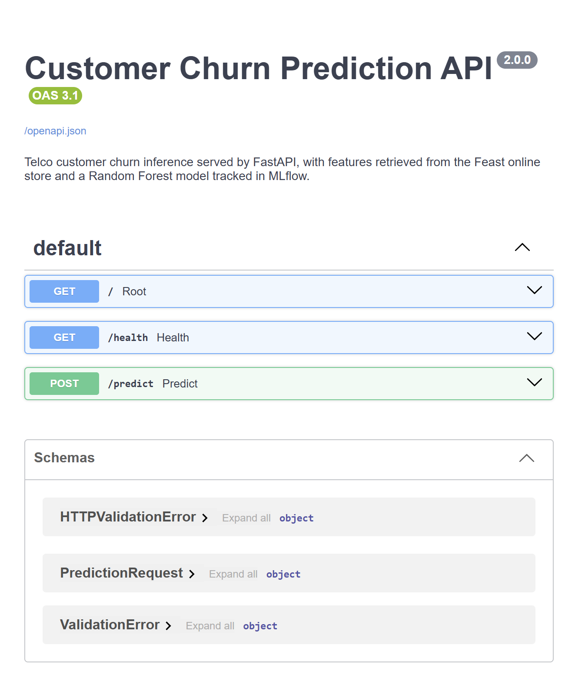
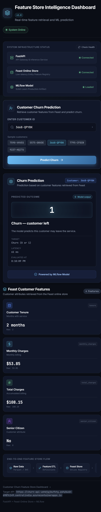
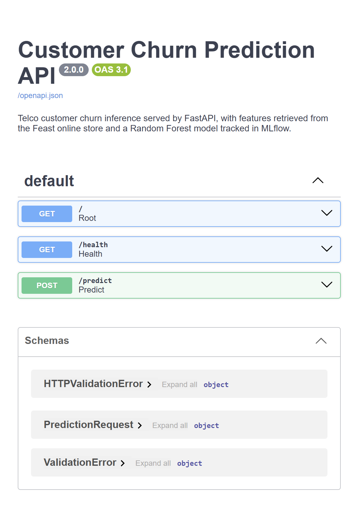

# Customer Churn Prediction — Feast + MLflow + FastAPI + React on Azure

An end-to-end, containerized customer churn prediction application. A Random
Forest model is trained on the Telco Customer Churn dataset, its features are
served through a Feast online store, and predictions are exposed by a FastAPI
backend and a React dashboard. Everything is built as Docker images, deployed
to Microsoft Azure, and released through GitHub Actions.



---

## Live deployment

| Component | URL |
| --- | --- |
| React frontend (Azure Container Apps + Nginx) | https://churn-web-uehdjgjbufktg.ashybush-6987c149.centralindia.azurecontainerapps.io |
| FastAPI backend (Azure Container Apps) | https://churn-api-uehdjgjbufktg.ashybush-6987c149.centralindia.azurecontainerapps.io |
| Swagger UI | https://churn-api-uehdjgjbufktg.ashybush-6987c149.centralindia.azurecontainerapps.io/docs |
| GitHub repository | https://github.com/Bhanu-Kishore/feature-store-project |

> Both apps scale to zero. The first request after an idle period may take
> 10–30 seconds while the Container Apps cold-start.

---

## Architecture



Azure Static Web Apps is not offered in any region permitted by the student
subscription's `sys.regionrestriction` policy, so the frontend runs as a second
Container App in the same managed environment. Both apps scale to zero and share
one environment, Log Analytics workspace and ACR.

Request flow for a prediction:

1. The browser sends `POST /predict` with a `customer_id`.
2. FastAPI asks the Feast online store for `tenure`, `monthly_charges`,
   `total_charges` and `senior_citizen`.
3. The Random Forest scores those four features and returns 0 (stayed) or
   1 (churned).
4. The response includes the features that were retrieved, the prediction,
   a human-readable label, and the churn probability.

---

## Technology stack

| Layer | Technology |
| --- | --- |
| Dataset | Kaggle / IBM Telco Customer Churn (static snapshot) |
| Data processing | Python 3.12, Pandas, PyArrow |
| Feature store | Feast 0.66 — file offline store, SQLite online store |
| Model | Scikit-learn Random Forest, serialized with MLflow + skops |
| Experiment tracking | MLflow 3.16 (local tracking store) |
| API | FastAPI 0.141, Uvicorn, Pydantic v2 |
| Frontend | React 18, Vite 6, Axios, lucide-react |
| Containers | Docker, Docker Compose, Nginx |
| Cloud | Azure Container Registry, Container Apps, Blob/Files Storage, Log Analytics |
| CI/CD | GitHub Actions |

---

## Repository structure

```
feature-store-project/
├── backend/                     # FastAPI + Feast + model
│   ├── app.py                   # API: /, /health, /predict
│   ├── feature_definitions.py   # Feast entity + feature view
│   ├── feature_store.yaml       # Feast registry / online store config
│   ├── prepare_data.py          # CSV cleaning + target encoding
│   ├── build_features.py        # Feast feature table (Parquet)
│   ├── prepare_training_data.py # Training dataset
│   ├── train_model.py           # MLflow training run
│   ├── model/                   # Exported, self-contained MLflow model
│   ├── scripts/
│   │   ├── build_feature_store.py   # feast apply + materialize
│   │   └── entrypoint.sh            # seed persistent volume, start Uvicorn
│   ├── tests/test_api.py        # pytest API tests
│   ├── Dockerfile
│   └── requirements*.txt
├── frontend/                    # React + Vite dashboard
│   ├── src/
│   ├── Dockerfile
│   └── nginx.conf
├── infra/
│   ├── main.bicep               # ACR, 2× Container Apps, Storage, Logs
│   ├── deploy.sh                # provisioning + image build + deploy
│   └── configure-github.sh      # writes GitHub secrets/variables
├── .github/workflows/ci-cd.yml  # test → build → deploy
├── docker-compose.yml
└── README.md
```

The original repository history is preserved: the former root-level Feast files
were moved to `backend/` with `git mv`, so file history remains traceable.

---

## Dataset

The project uses the **Telco Customer Churn** dataset (7,043 customers, 21
columns) published by IBM and mirrored on Kaggle. After cleaning `TotalCharges`
(blank values removed) the feature snapshot contains **7,032 customers** with a
churn rate of 26.5% (1,869 churned, 5,163 retained).

* Target: `Churn` — `Yes` → 1, `No` → 0.
* Model features: `tenure`, `monthly_charges`, `total_charges`,
  `senior_citizen`.
* Identifier: `customer_id` (renamed from `customerID`).

### About the timestamps

The Telco dataset is a **static snapshot**, not a longitudinal log. Feast
requires an event timestamp, so every row is assigned the same synthetic
timestamp (`2026-01-01T00:00:00Z`). This is a demonstration device for
materializing the online store — it does **not** represent genuine historical
customer behaviour or a real observation date.

The raw snapshot is committed at `backend/data/telco_customer_churn.csv`, so
builds and CI do not require a DVC remote. The original DVC tracking files are
kept under `backend/.dvc` and `backend/data/*.dvc`.

---

## Random Forest model

`backend/train_model.py` trains the model and logs it to MLflow:

| Item | Value |
| --- | --- |
| Algorithm | `RandomForestClassifier(n_estimators=100, class_weight="balanced", random_state=42)` |
| Train/test split | 80/20, stratified, `random_state=42` |
| Test accuracy | **0.7420** (74.20%) |
| MLflow run | `d38dea83b0c142a6be4790c017a1923e` |
| Experiment | `Customer_Churn_Feature_Store` |
| Serialization | MLflow model format with skops (`model.skops`) |

The production artifact is exported to `backend/model/`. `model/model_info.json`
records the run ID, feature order, estimator count and measured accuracy.

### Why the app does not load `runs:/...`

The original `app.py` loaded the model from a local MLflow run URI. That URI
points at a local `mlruns/` directory and an absolute Windows path, which does
not exist inside a Linux container or on Azure. The deployment therefore uses a
**self-contained model directory baked into the image**:

* `MODEL_PATH` (default `./model`) is loaded at startup with
  `mlflow.sklearn.load_model`.
* `MLFLOW_MODEL_URI` can override it for an MLflow-compatible URI when a
  registry or artifact store is available.
* The same artifacts are mirrored to Azure Blob Storage
  (`assets/model/`) for durable storage and recovery.

Retraining still uses MLflow tracking exactly as before.

---

## Feast feature store

`backend/feature_definitions.py` defines:

* Entity `customer` with join key `customer_id`.
* `FileSource` `telco_customer_features` reading
  `data/telco_features.parquet` (`event_timestamp`, `created_timestamp`).
* `FeatureView` `customer_features` with the four model features, `ttl=None`,
  online serving enabled.

`backend/feature_store.yaml` uses the local provider, a file registry
(`data/registry.db`) and a SQLite online store (`data/online_store.db`).

Build the registry and materialize the online store:

```bash
cd backend
python scripts/build_feature_store.py
```

This runs `FeatureStore.apply(...)` and `FeatureStore.materialize(...)` for the
synthetic timestamp window. The Docker image performs the same steps at build
time and keeps a copy in `/app/seed`.

### Persistence

* The image contains a ready-to-serve registry and online store.
* On Azure, an **Azure Files** share (`feast-data`) is mounted at `/app/data`.
  The entrypoint seeds it from `/app/seed` on the first start, and the SQLite
  state then survives container restarts and new revisions.
* If the mount is unavailable, the baked snapshot is used, so the API still
  works. Set `FORCE_FEAST_BOOTSTRAP=1` to re-run `apply` + `materialize` on
  startup.

---

## FastAPI backend

Start locally:

```bash
cd backend
CORS_ORIGINS="http://localhost:5173" uvicorn app:app --reload
```

| Method | Path | Description |
| --- | --- | --- |
| GET | `/` | Liveness message |
| GET | `/health` | Readiness: model and feature store status (503 if the model failed) |
| GET | `/docs` | Swagger UI |
| GET | `/openapi.json` | OpenAPI schema |
| POST | `/predict` | Churn prediction for one customer |

Example:

```bash
curl -X POST http://localhost:8000/predict \
  -H "Content-Type: application/json" \
  -d '{"customer_id":"3668-QPYBK"}'
```

```json
{
  "customer_id": "3668-QPYBK",
  "features": {
    "tenure": 2,
    "monthly_charges": 53.85,
    "total_charges": 108.15,
    "senior_citizen": 0
  },
  "prediction": 1,
  "prediction_label": "Churn — customer left",
  "churn_probability": 0.89
}
```

Unknown IDs return `404`; blank IDs return `422`; a missing model returns `503`.

### Environment variables

| Variable | Default | Purpose |
| --- | --- | --- |
| `FEAST_REPO_PATH` | `/app` | Directory containing `feature_store.yaml` |
| `MODEL_PATH` | `/app/model` | Exported MLflow model directory |
| `MLFLOW_MODEL_URI` | unset | Optional MLflow URI that overrides `MODEL_PATH` |
| `CORS_ORIGINS` | `*` | Comma-separated browser origins |
| `FORCE_FEAST_BOOTSTRAP` | `0` | Rebuild registry/online store at startup |

---

## Frontend

The dashboard shows backend/Feast/MLflow health, accepts a customer ID or a
sample ID, and renders the prediction plus the exact Feast features used.

* API base URL: `VITE_API_URL` (baked at build time; defaults to
  `http://127.0.0.1:8000`).
* Dev server proxy: `/api-proxy` → `http://127.0.0.1:8000` (see
  `vite.config.js`).
* Static hosting on Azure is a single-page app with `staticwebapp.config.json`
  navigation fallback and security headers.

```bash
cd frontend
npm ci
npm run dev           # http://localhost:5173
VITE_API_URL=https://<backend> npm run build
```

---

## Docker

| Service | Base image | Port | Health check |
| --- | --- | --- | --- |
| `backend` | `python:3.12-slim` | 8000 | `GET /health` |
| `frontend` | `node:22-alpine` → `nginx:1.27-alpine` | 80 | `GET /healthz` |

Run the complete stack:

```bash
docker compose up --build -d
docker compose ps
```

* Backend: http://localhost:8000 (Swagger at `/docs`)
* Frontend: http://localhost (port 80)
* Feast state lives in the `feast_data` named volume; the entrypoint seeds it
  on first use.

The backend image is ~1.3 GB because it contains Feast, MLflow, scikit-learn and
the model. The frontend image is ~74 MB.

Stop:

```bash
docker compose down          # keep the Feast volume
docker compose down -v       # also remove the volume
```

---

## Microsoft Azure deployment

| Service | Role | Tier |
| --- | --- | --- |
| Azure Container Registry | Stores backend and frontend images | Basic |
| Azure Container Apps (API) | Runs FastAPI/Uvicorn with ingress :8000 | Consumption (0.5 vCPU / 1 GiB) |
| Azure Container Apps (web) | Nginx serving the React build with ingress :80 | Consumption (0.25 vCPU / 0.5 GiB) |
| Azure Storage (Blob) | Dataset + model artifact mirror | Standard LRS |
| Azure Storage (Files) | Persistent Feast registry/online store | Transaction-optimized, 1 GiB |
| Log Analytics | Container logs | Per-GB (30-day retention) |

Infrastructure is defined in `infra/main.bicep` and deployed to
`centralindia` (the region allowed by the subscription policy). The managed
environment is pinned to `environmentMode: ConsumptionOnly`; new environments
default to Express, which does not support Azure Files mounts. ACR admin
credentials are passed to both Container Apps as an encrypted secret
(`passwordSecretRef`), so no credential is written to source control or to the
command line. Ingress is HTTPS-only. The API has readiness/liveness probes on
`/health`, HTTP scaling (min 0, max 1) and CORS limited to the frontend hostname
plus local development origins.

### Provision (requires billing approval)

```bash
az login
CONFIRM_DEPLOY=yes AZURE_LOCATION=centralindia ./infra/deploy.sh
```

`deploy.sh` prints the cost estimate, refuses to continue without
`CONFIRM_DEPLOY=yes`, creates the resources, builds both images locally and
pushes them to ACR (ACR Tasks are blocked by the student subscription policy),
updates both Container Apps, waits for `/health`, uploads assets to Blob, and
writes a git-ignored `.azure-deployment.env`. It also creates a scoped service
principal for CI by default.

### Cost estimate

| Resource | Estimated monthly cost |
| --- | --- |
| ACR Basic | ~$5.00 (fixed) |
| Container Apps (API) | $0 idle with `minReplicas=0`; covered by the monthly free grant at demo traffic |
| Container Apps (web) | $0 idle with `minReplicas=0` |
| Blob Storage | < $0.10 for <1 GiB |
| Azure Files (1 GiB) | ~$0.06 + transactions |
| Log Analytics | ~$0–1 at demo log volume |
| **Total** | **≈ $5–7/month while idle** |

ACR Basic is the main unavoidable recurring charge. Delete the resource group
or the registry when the demo is no longer needed. No paid plans, subscriptions
or purchases are made by the code.

---

## GitHub Actions CI/CD

`.github/workflows/ci-cd.yml` runs on every push and pull request:

1. **Backend tests** — installs dependencies, regenerates the dataset,
   features and Feast online store, runs `pytest`.
2. **Frontend build** — `npm ci` + `vite build`, uploads the artifact.
3. **Docker image builds** — builds backend and frontend images.
4. **Deploy to Azure** — on `main` only, after all checks pass and when the
   repository variable `AZURE_DEPLOY_ENABLED` is `true`: pushes both images to
   ACR, updates the API and web Container Apps, and smoke-tests
   `${BACKEND_URL}/health`.

Repository secrets:

| Secret | Value |
| --- | --- |
| `AZURE_CREDENTIALS` | Service principal JSON (`az ad sp create-for-rbac --sdk-auth`) |
| `ACR_NAME` | Registry name |
| `ACR_LOGIN_SERVER` | `*.azurecr.io` |
| `AZURE_RESOURCE_GROUP` | Resource group |
| `AZURE_CONTAINER_APP` | Backend Container App name |
| `AZURE_FRONTEND_APP` | Frontend Container App name |

Repository variables:

| Variable | Value |
| --- | --- |
| `BACKEND_URL` | Public Container App URL (used as `VITE_API_URL`) |
| `FRONTEND_URL` | Public frontend Container App URL |
| `AZURE_DEPLOY_ENABLED` | `true` enables the deploy job |

Configure them after provisioning:

```bash
CONFIRM_GITHUB_CONFIG=yes ./infra/configure-github.sh
```

If your tenant restricts automatic app-registration creation, create the
service-principal credential yourself (Owner or Application Administrator
needed), then rerun the script:

```bash
az ad sp create-for-rbac --name gh-churn-ci --role Contributor \
  --scopes /subscriptions/<subscription-id>/resourceGroups/rg-churn-feature-store \
  --sdk-auth > .azure-credentials.json
```

The deploy job builds both images with Docker and pushes them to ACR; it does
not use ACR Tasks, which are unavailable on this subscription. No secrets are
committed. `.azure-deployment.env`, `.azure-credentials.json` and `.env` files
are git-ignored.

---

## Testing

Backend tests (`backend/tests/test_api.py`):

```bash
cd backend
python prepare_data.py
python build_features.py
python prepare_training_data.py
python scripts/build_feature_store.py
python -m pytest
```

Coverage: root, health, Swagger/OpenAPI, valid prediction with exact Feast
features, unknown customer (404), blank ID (422), CORS headers. Latest local
run: **7 passed** (2026-11-22).

Local Docker verification performed:

* Backend image build — pass
* Frontend image build — pass
* `docker compose up --build -d` — both containers healthy
* `GET /health` — `{"status":"ok","model":"loaded","feature_store":"online"}`
* Swagger `/docs` — 200
* Valid prediction `7590-VHVEG` → 0 (stayed), probability 0.25
* Valid prediction `3668-QPYBK` → 1 (churned), probability 0.89
* Unknown customer → 404; blank customer → 422
* CORS preflight from `http://localhost` — 200
* Browser prediction flow — 0 and 1 both rendered
* Feast features displayed: `tenure`, `monthly_charges`, `total_charges`,
  `senior_citizen`
* Persistence: Feast registry/online store survive `docker compose restart`

Azure deployment verification (2026-11-22, `centralindia`):

* `GET /health` on the public backend → `200`
  `{"status":"ok","model":"loaded","feature_store":"online"}`
* `POST /predict` `7590-VHVEG` → 0 (stayed), probability 0.25, correct Feast features
* `POST /predict` `3668-QPYBK` → 1 (churned), probability 0.89, correct Feast features
* Unknown customer → `404`; the dashboard shows the request-error banner
* Dashboard prediction over HTTPS → 1 in 61 ms (browser, public frontend URL)
* Azure Files share `feast-data` contains `registry.db`, `online_store.db` and
  `telco_features.parquet`
* After restarting the API revision, the same prediction still succeeds
* ACR contains `churn-backend` and `churn-frontend` images tagged
  `20261122143238` and `latest`

Azure verification performed with `curl` and a real browser session against the
public URLs above. ACR Tasks are denied on this subscription
(`TasksOperationsNotAllowed`), so images are built with local Docker and pushed.

---

## Troubleshooting

| Symptom | Cause / fix |
| --- | --- |
| `Model not loaded` / 503 | `MODEL_PATH` must point to a directory containing `MLmodel` and `model.skops`; check container logs. |
| 404 on `/predict` | The customer ID is not in the online store. Regenerate with `python scripts/build_feature_store.py` or set `FORCE_FEAST_BOOTSTRAP=1`. |
| Feature lookup returns `None` | The online store was not materialized, or the mounted `/app/data` volume is empty and seeding failed (check write permissions). |
| CORS error in the browser | Add the exact frontend origin to `CORS_ORIGINS` and restart the Container App. |
| Frontend calls `localhost:8000` in production | Rebuild the frontend with `VITE_API_URL=<backend URL>`; Vite bakes this at build time. |
| Container App returns 502/503 on first request | Cold start (`minReplicas=0`). Retry after 10–30 s or set `MIN_REPLICAS=1`. |
| Image pull failure in ACA | Check the `acr-password` secret and registry entry; the credentials come from the ACR admin account provisioned by Bicep. |
| `ExpressEnvironmentResourceNotSupported` | The environment is an Express environment; recreate it with `environmentMode: 'ConsumptionOnly'`. |
| `TasksOperationsNotAllowed` from `az acr build` | ACR Tasks is disabled for the subscription; `deploy.sh` falls back to local `docker build` + `docker push`. |
| `.env` ignored by Git | Intentional. Commit `.env.example` instead. |
| `feast` can't find data | Run commands from `backend/`; `feature_store.yaml` uses paths relative to the repo root. |

---

## Screenshots

| Dashboard | Swagger |
| --- | --- |
|  |  |

The same UI and Swagger rendered by the public Azure deployment:

| Azure dashboard | Azure Swagger |
| --- | --- |
|  |  |

---

## Security and limitations

* CORS is restricted to the deployed frontend and local dev origins.
* HTTPS-only ingress; ACR admin credentials live only in encrypted Container App
  secrets. For a longer-lived deployment, prefer user-assigned managed identities
  with `AcrPull` and disable the admin account.
* The demo runs a single API replica (0.5 vCPU / 1 GiB) and uses SQLite for the
  online store. For higher traffic, use a managed online store
  (Redis/Postgres), a replicated registry, and a real monitoring/alerting setup.
* Predictions describe a static historical dataset. The model has ~74% test
  accuracy and is not a production credit/retention decision system.
* The synthetic feature timestamp is not real customer activity (see Dataset).

---

## Data attribution

Telco Customer Churn is a public sample dataset originally published by IBM and
distributed via Kaggle. Refer to the Kaggle dataset page and IBM's terms for
usage conditions.
